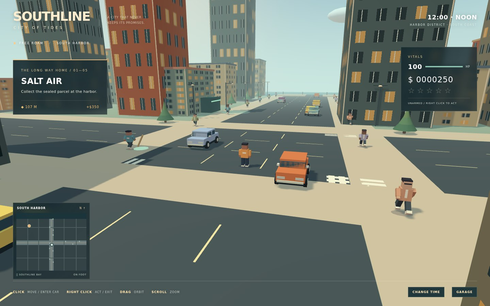

# Southline: City of Tides

[](https://make.fun/competitions/gta6-01)
[](https://make.fun/competitions/gta6-01)
[](https://make.fun/competitions/gta6-01)

A fully offline, real-time **3D WebGL** browser crime sandbox. Pastel waterfront blocks, soft shadows, traffic, pedestrians, five sequential contracts, escalating police pursuits, and three distinct coastal lighting moods. Starts directly in a playable solo city: no title-screen barrier, downloads, remote assets, or build step.



## Run

Requires Node.js 22.18+ (or Node.js 24+) and a modern browser with WebGL2 enabled.

```sh
node serve.ts
```

Open **http://localhost:8080**. All dependencies and assets are local. A software WebGL implementation works for headless capture; hardware acceleration is recommended for play.

Package the game and screenshots, including the generated dossier:

```sh
mkdir -p out && MAKEFUN_OUTPUT_DIR=out node main.ts
```

## Controls

| Input | Action |
| --- | --- |
| Left-click ground | Run there; in a vehicle, navigate there |
| Left-click vehicle | Approach and enter a nearby intact vehicle |
| Right-click | Punch, swing bat, fire pistol; exit vehicle when driving |
| Drag | Orbit the follow camera |
| Scroll | Zoom the camera |
| WASD / arrow keys | Walk; accelerate/reverse and steer when driving |
| CHANGE TIME | Cycle NOON → DAY → NIGHT |
| GARAGE | Open repair, paint, and save controls |
| BACK TO THE STREETS | Restart after death |

Click movement uses obstacle-aware pathfinding. Manual driving is faster and more precise on corners. Right-click attacks the nearest valid target within weapon range. The bat is by the west sidewalk at the junction; the pistol is on the east sidewalk farther south. Walk over a pickup to equip it.

## Contracts And Heat

1. **Salt Air:** collect a harbor parcel at the gold beacon.
2. **Rear View:** close to within 13 meters of the moving purple courier.
3. **Clean Delivery:** steal the gold coupe, then deliver it to the motel beacon.
4. **No Witnesses:** lose the police, then reach the escape waypoint.
5. **Salt in the Wound:** destroy the marked red car at the marina.

Contracts pay automatically. Theft, collisions, violence, and gunshots raise wanted level. Police pursue and damage you; three stars introduce roadblocks, four stars bring a helicopter and spotlight. Break away for long enough to lose stars. A destroyed occupied car is fatal. The city remains playable after the final contract.

**Tideline Customs** is the turquoise pad on the west sidewalk, 32 meters north of the central junction. Bring a vehicle within eight meters to repair it for $100 or change paint. Repairs also restore health. Save City stores money, completed contracts, position, weapon, time, and vehicle condition/color in localStorage; these restore after reload. Restart clears the save.

## Screenshots And Verification

`?shot=start`, `?shot=play`, and `?shot=end` start the same real scene at noon, warm morning, and night. `shots.json` records each camera, target, field of view, lighting, and output path. The camera stands approximately 24 meters from the visible character, at 7.4 meters high, with a 59° perspective lens. The JPEGs in `screenshots/` are actual Chrome WebGL captures, not illustrations or starter images.

Verified in headless Google Chrome using software WebGL2: engine initialization without browser errors; entering/driving/exiting cars; vehicle destruction; all five contract transitions and payouts; wanted escalation to roadblocks and helicopter; bat pickup and combat; fatal explosion and restart; garage repair/repaint; saved state after reload; and all three capture routes. HUD and minimap use HTML/SVG overlays over a true Three.js 3D scene. Window canvases use WebGL scissor-painted textures, never a 2D rendering context.

## Roadmap

- Implemented: compact open city, vehicles, traffic, NPCs, contracts, weapons, police escalation, garage saves, lighting, and reproducible captures.
- Future: expanded islands and interiors, richer traffic routing, audio, and additional contract stories.
- Current scope: stylized arcade handling, a compact single-player district, no multiplayer or interiors. Saves are local to the browser and origin.

## Attributions

- **Three.js**, MIT license, by the Three.js authors; bundled under `game/vendor/`, with its license at `game/vendor/LICENSE`.
- **make.fun** starter submission/server tooling; its original license is preserved at `LICENSE`.
- City geometry, procedural WebGL window textures, palette, interface, gameplay, and captures are generated specifically for Southline. No externally hosted art, fonts, sound, or services are required.
- This is an original fictional game, not affiliated with Rockstar Games or Grand Theft Auto.

## Authors

**MahendraS122** — project author and direction. Implementation assisted by OpenAI Codex.
